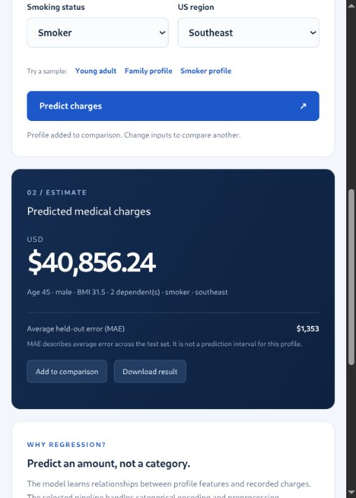

# Insurance Charge Predictor — BTech Mini Project

A complete supervised regression project with a working local interface. Enter age, sex, BMI, dependents, smoking status, and US region to estimate the `charges` field in a public medical-cost benchmark.

The project predicts a numerical charge, **not a category and not a current insurance premium**. Amounts are in USD. It is designed for academic demonstrations, not real underwriting or price quotations.

## Quick start on another computer

Python **3.12** is recommended. Open a terminal in this project folder:

```bash
python -m venv .venv
source .venv/bin/activate
# Windows instead: .venv\Scripts\activate
pip install -r requirements.txt
python src/train.py
python src/verify.py
python run.py
```

Open **http://127.0.0.1:8502**. Leave the terminal running; Ctrl+C stops the app. If the port is occupied, run `python run.py --port 8503` and open http://127.0.0.1:8503.

Internet is needed for first-time package installation. Data are already included, and training and inference work offline afterward. Retraining is recommended after installing dependencies so the saved pipeline matches the installed library versions. The included serialized model was created using the versions in `reports/tested_versions.json`. Load only trusted joblib model files.

## Project preview



## Evaluation documents

- [PowerPoint presentation](docs/Insurance_Charge_Predictor_Presentation.pptx)
- [Project report](docs/Insurance_Charge_Predictor_Report.docx)
- [Explanation from scratch](reports/EXPLAINED_FROM_SCRATCH.md)
- [Viva questions and demo guide](reports/VIVA_AND_DEMO.md)

The report starts footer page numbering at Chapter 1. Organisation, mentor, semester, and internship dates are editable placeholders to complete before submission.

## What to demonstrate

1. Open **Predict charges**, choose **Family profile**, and predict.
2. Add it to comparison, choose **Smoker profile**, predict again, and add that profile.
3. Explain that the difference illustrates a learned association, not a causal experiment.
4. Open **Model evaluation** to show MAE, RMSE, R², cross-validation comparison, and charts.
5. Open **Data & workflow** to show 1,338 original records, one duplicate removed, and 1,337 clean records.
6. Open **Batch prediction**, select the included example, predict five rows, and download the CSV.

## Measured results

Model selection uses the lowest five-fold cross-validation MAE on the 1,069 training records. The separate 268-record test set is evaluated afterward.

| Quantity | Value |
|---|---:|
| Selected model | Gradient boosting |
| Training CV MAE | $2,097.37 |
| Test MAE | $1,352.65 |
| Test RMSE | $3,297.50 |
| Test R² | 0.9246 |

R² is not a classification accuracy percentage. The lower held-out error compared with cross-validation shows that the particular split matters. The project does not claim that every future prediction has an error of $1,352.65. MAE is an average, not an individual confidence interval.

## Folder structure

```text
insurance_charge_predictor/
  run.py                        Local server and prediction APIs
  requirements.txt              Python dependencies
  walkthrough.ipynb             Optional Jupyter explanation
  data/
    raw.csv                     Untouched downloaded dataset
    clean.csv                   Normalized data, exact duplicates removed
    removed_rows.csv            Audit of excluded records
    split_manifest.csv          Source rows assigned to train or test
    example_profiles.csv        Five feature-only demo rows
    SOURCE.md                   Dataset attribution and fingerprint
  src/
    schema.py                   Shared feature rules and validation
    train.py                    Cleaning, comparison, training and charts
    predict.py                  Saved-pipeline inference and CLI
    verify.py                   Data, split, metric and validation checks
  models/charge_model.joblib     Selected fitted pipeline
  web/                          HTML, CSS and JavaScript interface
  docs/                         Evaluation presentation and Word report
  reports/                      Metrics, charts, report and viva material
```

## Predict from a CSV in the terminal

```bash
python src/predict.py data/example_profiles.csv
```

Use exactly these columns: `age,sex,bmi,children,smoker,region`. Do not include `charges`. Numeric inputs must be finite and within the dataset's ranges; age and dependents must be whole numbers. Categories are validated explicitly. Form requests are processed locally and are not saved by the server. Browser scenario comparisons last only until the page is refreshed.

For your submission, read `reports/PROJECT_REPORT.md`, `reports/EXPLAINED_FROM_SCRATCH.md`, and `reports/VIVA_AND_DEMO.md`. Add your student and college details. The notebook is optional and requires a Jupyter environment; the main app does not.
